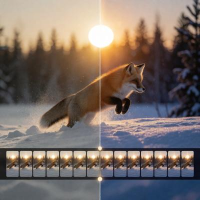

# ComfyUI Nvidia VFX Nodes

> Previously called Nvidia RTX Nodes for ComfyUI

ComfyUI nodes for VFX professionals. This extension provides GPU-accelerated nodes powered by Nvidia RTX technology and its `nvidia-vfx` Python bindings.

Including:

- **RTX Video Super Resolution**: upscale, denoise, deblur, or enhance images and video frames.
- **RTX Video HDR**: convert SDR images to normalized BT.2020/PQ or BT.2020/HLG HDR image data.
- **RTX Video Frame Generation**: interpolate frames between adjacent images for frame-rate conversion or slow motion.

## Requirements

- An Nvidia RTX GPU (RTX Spark is supported).
- A working ComfyUI installation with CUDA-enabled PyTorch (cu130 or higher pytorch is required).
- The nodes use the CUDA device selected by ComfyUI. CPU-only execution and non-NVIDIA GPUs are not supported.
- RTX Video Frame Generation is supported on Nvidia 40 series and later only.

## Installation

### ComfyUI Manager

1. Open **ComfyUI Manager**.
2. Search for **ComfyUI Nvidia VFX Nodes**.
3. Install the extension and restart ComfyUI.

### Manual installation

Clone the repository into `ComfyUI/custom_nodes`, then install its dependency with the Python interpreter used by ComfyUI:

```bash
cd ComfyUI/custom_nodes
git clone https://github.com/Comfy-Org/ComfyUI_Nvidia_VFX_Nodes.git
cd ComfyUI_Nvidia_VFX_Nodes
python -m pip install -r requirements.txt
```

Restart ComfyUI after installation.

## RTX Video Super Resolution

Find the node under **image/upscaling**. It accepts a ComfyUI `IMAGE` batch and returns `upscaled_images` as another `IMAGE` batch.

### Inputs

| Input | Values | Description |
| --- | --- | --- |
| `images` | `IMAGE` batch | Images or decoded video frames to process. |
| `resize_type` | `scale by multiplier` / `target dimensions` | Selects how upscaled output dimensions are calculated. |
| `scale` | `1.00`–`4.00`, default `2.00` | Width and height multiplier. Available when scaling by multiplier. |
| `width` | `64`–`8192`, default `1920` | Requested output width. Available for target dimensions. |
| `height` | `64`–`8192`, default `1080` | Requested output height. Available for target dimensions. |
| `quality` | See below; default `ULTRA` | Selects the VFX processing model. |
| `strength` | `0.00`–`1.00`, default `1.00` | Effect strength. |
| `image_encoding` | `8-bit RGB` / `10-bit RGB (RGB10A2)` | Pixel encoding used internally by the SDK. |

The 10-bit option packs ComfyUI's normalized RGB values into RGB10A2 before inference and unpacks the result back to a normal ComfyUI `IMAGE`. It preserves more precision but does not convert SDR content to HDR.

### Quality modes

| Modes | Operation |
| --- | --- |
| `BICUBIC` | Non-AI bicubic interpolation. |
| `LOW`, `MEDIUM`, `HIGH`, `ULTRA` | Standard AI upscaling for typical compressed sources, from fastest to maximum detail preservation. |
| `DENOISE_LOW`, `DENOISE_MEDIUM`, `DENOISE_HIGH`, `DENOISE_ULTRA` | Same-resolution noise and compression-artifact removal. Higher levels remove more noise but may soften texture. |
| `DEBLUR_LOW`, `DEBLUR_MEDIUM`, `DEBLUR_HIGH`, `DEBLUR_ULTRA` | Same-resolution sharpening for soft or blurry sources. |
| `HIGHBITRATE_LOW`, `HIGHBITRATE_MEDIUM`, `HIGHBITRATE_HIGH`, `HIGHBITRATE_ULTRA` | AI upscaling for clean, high-bitrate, or lossless sources; avoids unnecessary artifact suppression. |
| `STREAMING_MEDIUM`, `STREAMING_ULTRA` | Upscaling optimized for broadcast and webcam streams. |

`DENOISE_*` and `DEBLUR_*` always keep the input dimensions, regardless of the selected resize settings. All other modes use the requested output size, rounded to the nearest multiple of 8. To limit working memory, the node chooses a chunk size targeting no more than 16 megapixels of output at once, with a minimum of one frame per chunk.

### Image workflow

Connect an image batch to **RTX Video Super Resolution**, choose an operation and settings, then connect `upscaled_images` to **Save Image** or another image node.


### Video workflow

Decode a video to an `IMAGE` batch, process the frames, and pass the result to video creation/encoding nodes. Super Resolution changes frame dimensions but not frame count or frame rate.


Importable Super Resolution examples are available in [`example_workflows`](example_workflows):

- [`rtx_image_upscale.json`](example_workflows/rtx_image_upscale.json)
- [`rtx_video_upscale.json`](example_workflows/rtx_video_upscale.json)

## RTX Video HDR

Find the node under **image/enhancement**. It converts each SDR input image with NVIDIA RTX Video HDR and returns `hdr_images` at the original dimensions.

### Inputs

| Input | Range/default | Description |
| --- | --- | --- |
| `images` | `IMAGE` batch | Normalized SDR RGB input images. |
| `contrast` | `0`–`200`, default `100` | Output contrast. |
| `saturation` | `0`–`200`, default `100` | Output saturation. |
| `middle_gray` | `10`–`100`, default `50` | Middle-grey reference level. |
| `luminance` | `400`–`2000`, default `650` | Target HDR display peak luminance in nits. |
| `debanding` | default enabled | Applies the SDK's DL-Debander pass. |
| `output_colorspace` | `HDR` / `HDR PQ` | Selects BT.2020/HLG or BT.2020/PQ output data. Default: `HDR` (HLG). |

`HDR PQ` returns the SDK's BT.2020/PQ signal as normalized RGB values. `HDR` converts that result to BT.2020/HLG using the selected peak luminance.

> [!IMPORTANT]
> A ComfyUI `IMAGE` does not carry HDR color-space metadata. The values this node outputs are meant for HDR workflows — downstream tools that save the video or image need to mark or encode them with the selected transfer function. If you display or save them as regular SDR data, they won't look the way HDR intends.

### Workflow

Decode a video to an `IMAGE` batch, connect it to **RTX Video HDR**, then pass `hdr_images` to video creation/encoding or image saving nodes.


Importable example: [`rtx_video_hdr.json`](example_workflows/rtx_video_hdr.json)

### Long video workflow

For long videos, process the frames in chunks to limit memory use. The loop crops `Frames per Chunk` frames per iteration with **Video Temporal Crop**, converts them with **RTX Video HDR**, and joins the results with **Concatenate Video**. Set the loop count to the number of chunks needed to cover the whole video.



Importable example: [`rtx_long_video_hdr.json`](example_workflows/rtx_long_video_hdr.json)

## RTX Video Frame Generation

Find the node under **video**. It processes every adjacent pair in an input `IMAGE` batch and returns `interpolated_images`, containing the original frames plus generated intermediate frames.

At least two input frames are required for interpolation. A one-frame batch is returned unchanged.

### Inputs

| Input | Values | Description |
| --- | --- | --- |
| `images` | `IMAGE` batch | Ordered source video frames. |
| `generation_type` | `frame rate multiplier` / `specific timestep` | Selects uniform frame multiplication or one explicit interpolation position per pair. |
| `multiplier` | `2`–`16`, default `2` | Output frame-rate multiplier. Available in multiplier mode. |
| `timestep` | `0.01`–`0.99`, default `0.50` | Position between the previous frame (`0`) and current frame (`1`). Available in timestep mode. |
| `mode` | `LOW`, `MEDIUM`, `HIGH`; default `MEDIUM` | Frame-generation quality mode. |
| `automatic_shot_change_detection` | default enabled | Lets the SDK detect shot boundaries automatically. |
| `shot_change` | default disabled | Advanced option that marks every submitted pair as a shot change; useful when processing one known cut. |
| `image_encoding` | `8-bit RGB` / `10-bit RGB (RGB10A2)` | Pixel encoding used internally by the SDK. |

### Output timing

For \(N\) input frames and multiplier \(M\), multiplier mode returns \((N - 1)M + 1\) frames. To preserve the source video's duration, multiply its frame rate by \(M\) when encoding the output.

Specific-timestep mode inserts one generated frame between each pair and returns \(2N - 1\) frames. A timestep of `0.5` creates evenly spaced 2× interpolation. Other timestep values create nonuniform temporal spacing, so use them for selecting frames or with a downstream workflow that can represent custom timestamps.

### Workflow

Decode a video to an `IMAGE` batch, connect it to **RTX Video Frame Generation**, then encode `interpolated_images` at the adjusted frame rate.


Importable example: [`rtx_video_frame_generation.json`](example_workflows/rtx_video_frame_generation.json)

## Implementation notes

ComfyUI images use channels-last `(B, H, W, C)` tensors. The nodes move each frame to ComfyUI's selected CUDA device, convert it to the SDK's channels-first RGB8 or packed RGB10A2 representation, and pass it through DLPack. Every SDK-owned DLPack result is cloned immediately before the next inference call or before the effect closes, then converted back to a standard channels-last ComfyUI `IMAGE`.

## Troubleshooting

- **`nvidia-vfx` cannot be imported:** install `requirements.txt` with the same Python interpreter that launches ComfyUI, then restart it.
- **CUDA/device error:** confirm that ComfyUI is using CUDA-enabled PyTorch and has selected a supported NVIDIA RTX GPU.
- **VFX load or inference error:** verify the dimensions, GPU support, driver/runtime installation, and available VRAM. The bindings report SDK failures as `nvvfx.NvVFXError`.
- **Out of memory:** reduce the resolution, scale factor, quality level, or number of frames supplied in one batch.
- **Super Resolution output size differs slightly from the requested multiplier:** upscaling dimensions are rounded to the nearest multiple of 8.
- **HDR output looks incorrect:** ensure downstream tools interpret the data as BT.2020/HLG for `HDR` or BT.2020/PQ for `HDR PQ`; do not treat it as SDR/sRGB.
- **Generated video duration is wrong:** adjust the encoded output frame rate as described under [Output timing](#output-timing).

## License

Licensed under Apache License 2.0. See [`LICENSE`](LICENSE).
